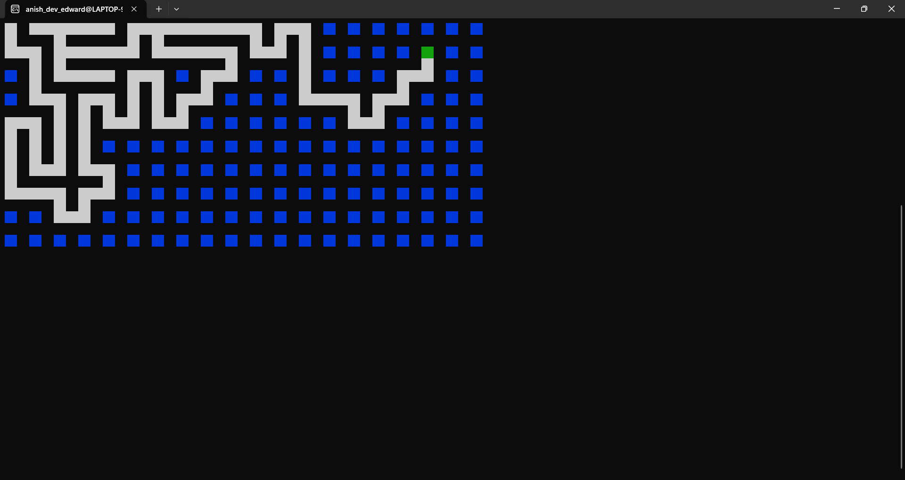
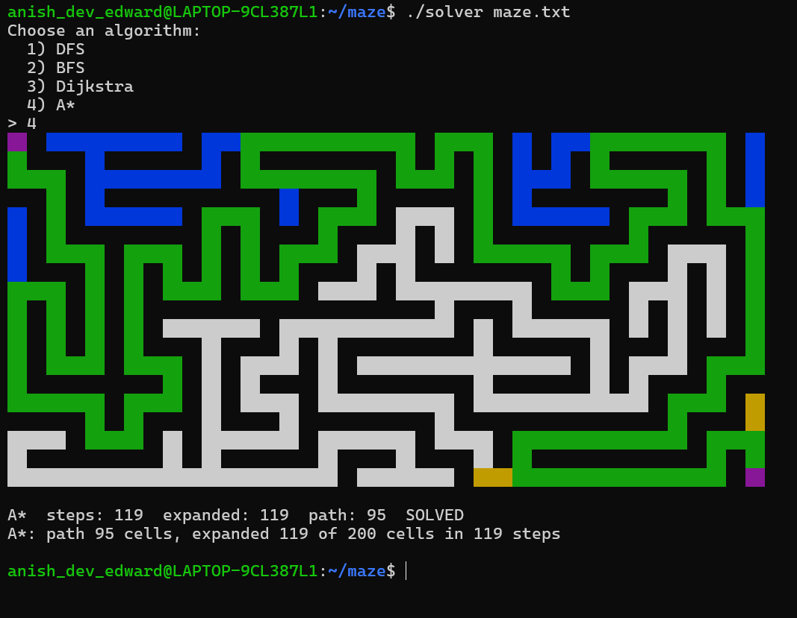
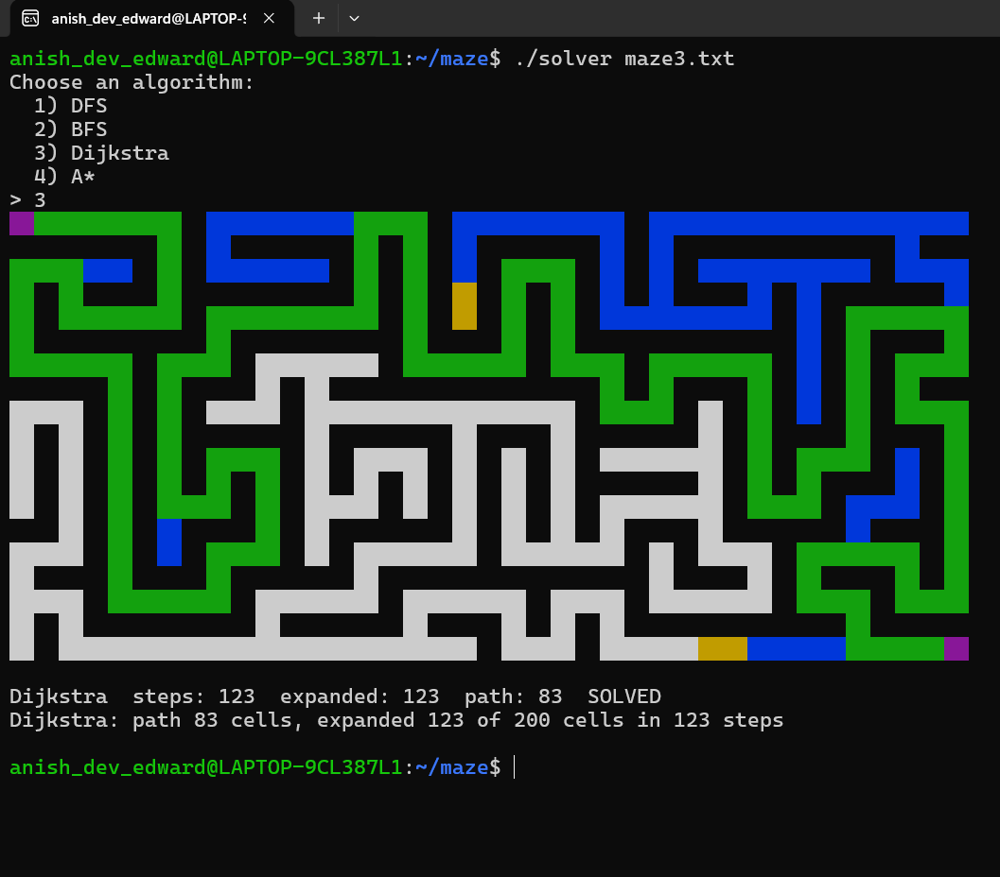

# Terminal Maze Generator & Pathfinder

A C++17 terminal-based maze generator and pathfinding visualizer rendered directly in the console using ANSI escape codes—requiring zero external graphics libraries.

## Overview

The project is split into two modular programs:
1. **Maze Generator (`maze.cpp`)**: Uses the recursive backtracker algorithm to carve out a maze in real time and exports the grid layout to a plain-text file.
2. **Maze Solver (`main.cpp` + algorithm helpers)**: Loads a generated maze file and animates pathfinding algorithms step-by-step until the goal is reached.

### Supported Algorithms
* **DFS** (`dfs.cpp`): Depth-First Search — dives down a single branch until hitting a dead end, then backtracks.
* **BFS** (`bfs.cpp`): Breadth-First Search — expands outward evenly layer by layer, guaranteeing the shortest path.
* **Dijkstra** (`dijkstra.cpp`): Always expands the lowest-cost known cell from the start.
* **A\*** (`astar.cpp`): Uses Dijkstra's cost plus a Manhattan-distance heuristic to guide the search directly toward the goal.

---

## Screenshots

### Maze Generation (Recursive Backtracker)


### Solving with A*


### Solving with Dijkstra


---

## Project Structure

```text
├── maze.cpp         # Maze generator & text exporter
├── main.cpp         # Solver runner, CLI parser & ANSI terminal renderer
├── dfs.cpp          # Depth-First Search implementation
├── bfs.cpp          # Breadth-First Search implementation
├── dijkstra.cpp     # Dijkstra's algorithm implementation
├── astar.cpp        # A* search implementation
└── images/          # README screenshots
```

---

## Color Legend

| Color | Generator (`maze`) | Solver (`solver`) |
| :--- | :--- | :--- |
| **White** | Carved passage | Unvisited maze corridor |
| **Blue** | Unvisited cell | Closed / Backtracked cell |
| **Yellow** | — | Open frontier / Current DFS stack |
| **Red** | — | Active cell being evaluated |
| **Green** | Current carving head | Final shortest path |
| **Magenta** | — | Start & Goal positions |

---

## Setup Guide

### 1. Prerequisites
You need a **C++17 compiler** (`g++` or `clang++`) and a terminal that supports ANSI colors:
* **Linux (Ubuntu/Debian):**
  ```bash
  sudo apt update && sudo apt install build-essential git
  ```
* **macOS:**
  ```bash
  xcode-select --install
  ```
* **Windows:**
  * Install **MSYS2** or **MinGW-w64** (to get `g++`), or use **WSL (Windows Subsystem for Linux)**.
  * Use **Windows Terminal** or **PowerShell** (ANSI colors are built in and supported out of the box).

Verify that `g++` is installed:
```bash
g++ --version
```

### 2. Download the Project
Clone the repository and move into the project folder:
```bash
cd maze
```
### 3. Compile the Programs
Run the following commands to build both executables:
```bash
# Compile the maze generator
g++ -std=c++17 -O2 maze.cpp -o maze

# Compile the maze solver (includes algorithm helpers inline)
g++ -std=c++17 -O2 main.cpp -o solver
```

---

## Usage

### 1. Generate a Maze
```bash
./maze [width] [height] [pathWidth] [delayMs] [outputFile]
```
* **Default run** (20x10 maze, saved to `maze.txt`):
  ```bash
  ./maze
  ```
* **Custom size & speed**:
  ```bash
  ./maze 30 15 1 20 custom_maze.txt
  ```

### 2. Solve a Maze
```bash
./solver [mazeFile] [algorithm] [pathWidth] [delayMs]
```
* **Interactive menu**:
  ```bash
  ./solver maze.txt
  ```
* **Direct launch** (algorithms: `dfs`, `bfs`, `dijkstra`, `astar`, or `1`–`4`):
  ```bash
  ./solver maze.txt astar 1 30
  ```

*(Note: On Windows Command Prompt/PowerShell, replace `./maze` and `./solver` with `maze.exe` and `solver.exe`.)*

---

## Credits

* Recursive backtracker logic inspired by javidx9's `olcConsoleGameEngine` maze tutorial ([OneLoneCoder.com](https://onelonecoder.com)).
